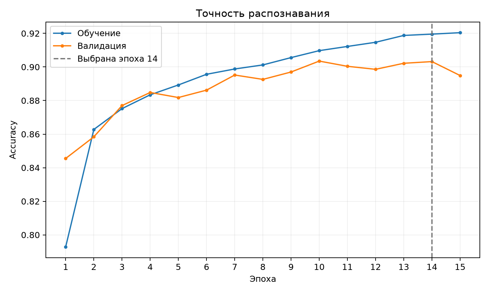
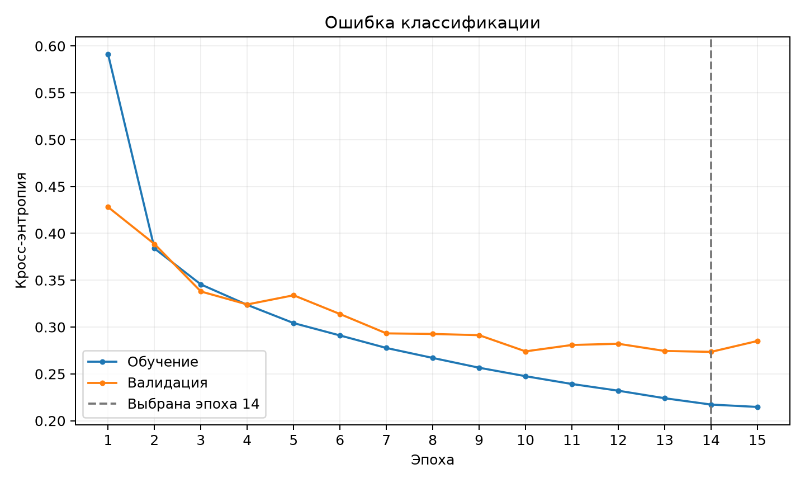

# Распознавание одежды на Fashion-MNIST

Учебный эксперимент: обучение свёрточной сети с нуля, затем дообучение сохранённой сети после добавления собственных изображений тех же категорий. Первый этап выполнен; второй — после подготовки новых данных. Результаты получены реальным запуском обучения и тестирования.

Первый этап завершён: тестовая точность **89,83%** (8983 правильных ответа из 10 000), тестовая кросс-энтропия **0,292023**. Выполнено 15 эпох; модель эпохи 14 выбрана по минимуму валидационной ошибки. Сохранённые веса, графики и численные результаты находятся в [results/before](results/before). Второй этап ещё не выполнялся.





В репозитории сохранены исходники, модели, результаты первого этапа и индексы разделения выборок. Виртуальное окружение и загружаемый датасет не включены: окружение устанавливается из файла зависимостей, Fashion-MNIST загружается автоматически при запуске.

## Первый этап

Используется весь официальный набор: 50 000 изображений для обучения, 10 000 для валидации и отдельные 10 000 для теста. В обучающей части по 5000 примеров каждого класса, в валидационной — по 1000. Валидация не участвует в обновлении весов. Индексы разделения сохраняются в `data/split.npz`; seed равен 42.

Архитектура из примера преподавателя: вход 28×28×1 → Conv(6, 3×3, same) → ReLU → MaxPool(2×2) → Conv(12, 3×3, same) → ReLU → MaxPool(2×2) → Flatten(588) → Dense(64) → ReLU → Dense(10) → Softmax. Всего 39 066 обучаемых параметров. Веса свёрток и скрытого Dense инициализируются по He. Оптимизатор Adam, начальный шаг 0.001, кросс-энтропия, батч 128, 15 эпох. В отличие от математического примера, для практического обучения используется Adam вместо обычного SGD; архитектура сохранена.

Лучшая модель выбирается только по минимальной валидационной ошибке. После обучения она один раз оценивается на тестовой выборке. Тест не используется для выбора эпохи или настройки параметров. Графики показывают все эпохи и отмечают выбранную. Модель последней эпохи также сохраняется отдельно. Повторные запуски на другом оборудовании могут немного отличаться.

## Запуск на этом компьютере

Откройте эту папку в PyCharm. Укажите интерпретатор `.venv/bin/python` из этой папки. Для запуска через PyCharm откройте `experiment.py` и в конфигурации запуска задайте параметр `baseline`.

В терминале из папки проекта:

```bash
./.venv/bin/python experiment.py baseline
```

Для установки после клонирования репозитория с Python 3.11 или 3.12:

```bash
python3 -m venv .venv
source .venv/bin/activate
pip install -r requirements.txt
python experiment.py baseline
```

Первый запуск требует интернета для загрузки Fashion-MNIST. Существующую папку результатов скрипт не перезаписывает. Для нового независимого запуска сначала переименуйте прежнюю папку результатов и сохраните её.

## Что сохраняется

В `results/before/`:

- `best.keras` — модель выбранной эпохи вместе с состоянием оптимизатора, основа для будущего дообучения.
- `last.keras` — модель последней эпохи.
- `accuracy.png`, `loss.png` — кривые обучения и валидации.
- `architecture.png`, `architecture.txt`, `layers.csv` — схема и слои.
- `confusion_matrix.png`, `confusion_matrix.csv` — матрица ошибок (строки — истинные классы).
- `predictions.png`, `errors.png` — предсказания и примеры ошибок.
- `kernels.png` — шесть обученных ядер первой свёртки.
- `metrics.json`, `history.csv`, `history.json`, `per_class.csv` — численные результаты.
- `test_predictions.npz` — вероятности и ответы на всех 10 000 тестовых изображениях.
- `results.txt` — краткое описание фактических результатов.

Полное окружение фиксируется в `requirements-lock.txt`. Веса не входят в исходный код: они получаются только после запуска обучения.

## Подготовка примерно 50 новых изображений

Разложите размеченные изображения в `new_images/` по папкам. Номер папки задаёт метку:

| Папка | Класс |
|---|---|
| 0_tshirt | Футболка или топ |
| 1_trouser | Брюки |
| 2_pullover | Пуловер |
| 3_dress | Платье |
| 4_coat | Пальто |
| 5_sandal | Сандалии |
| 6_shirt | Рубашка |
| 7_sneaker | Кроссовки |
| 8_bag | Сумка |
| 9_ankle_boot | Ботильоны |

Желательно примерно по пять новых изображений каждого класса. Предмет должен быть виден целиком, занимать основную часть кадра, находиться на чёрном фоне и быть светлее фона, как в Fashion-MNIST. Фото людей в одежде и сложный фон сильно отличаются от исходного набора. Нужна предварительная подготовка: вырезать предмет и привести фон к единому виду. Автоматическое изменение размера само по себе не удаляет фон.

Поддерживаются PNG, JPG, JPEG, BMP, WebP. Скрипт преобразует картинки в оттенки серого, сохраняет пропорции, дополняет чёрными полями до 28×28 и делит значения на 255. Если подготовленные изображения имеют белый фон и тёмный предмет, можно применить `--invert`; флаг действует ко всем новым изображениям, поэтому не смешивайте два варианта фона. Прозрачность желательно заранее убрать, сохранив чёрный фон. Перед обучением нужно визуально проверить подготовленные изображения и их метки.

Не добавляйте копии обучающих, валидационных или тестовых изображений Fashion-MNIST. Для отдельной проверки качества на ваших фотографиях понадобится ещё независимая группа изображений: обучаться на всех 50 и оценивать качество на тех же 50 некорректно.

## Второй этап — пока не запускать без новых данных

```bash
./.venv/bin/python experiment.py finetune --new-data new_images
```

Скрипт загрузит `results/before/best.keras`, уменьшит шаг Adam до 0.0001 и выполнит 5 эпох на исходных 50 000 обучающих изображениях вместе с новыми. Валидационная и тестовая выборки остаются неизменными. Новые изображения добавляются однократно, без искусственного многократного повторения; поэтому влияние 50 примеров на общую точность может оказаться малым. Эти настройки — начальный план второго этапа, который стоит проверить после просмотра новых данных.

Результаты второго этапа сохраняются в `results/after/`, включая `comparison.txt`, `comparison.png` и `combined_curves.png`. Исходные результаты сохраняются. Второй этап начинается с лучшей эпохи первого этапа; соединённые кривые показывают последовательность выполненных запусков, а не обучение без возврата к выбранным весам.

Сравнение «до и после» покажет совместный эффект новых данных и дополнительных эпох. Для вывода, что улучшение вызвано именно новыми изображениями, нужен контрольный запуск с тем же числом дополнительных эпох без новых данных. Один запуск и небольшая разница в точности не доказывают устойчивое улучшение.

## Источники

- Fashion-MNIST: https://github.com/zalandoresearch/fashion-mnist
- Загрузка набора: https://www.tensorflow.org/api_docs/python/tf/keras/datasets/fashion_mnist/load_data
- Сохранение лучшей модели: https://www.tensorflow.org/api_docs/python/tf/keras/callbacks/ModelCheckpoint
